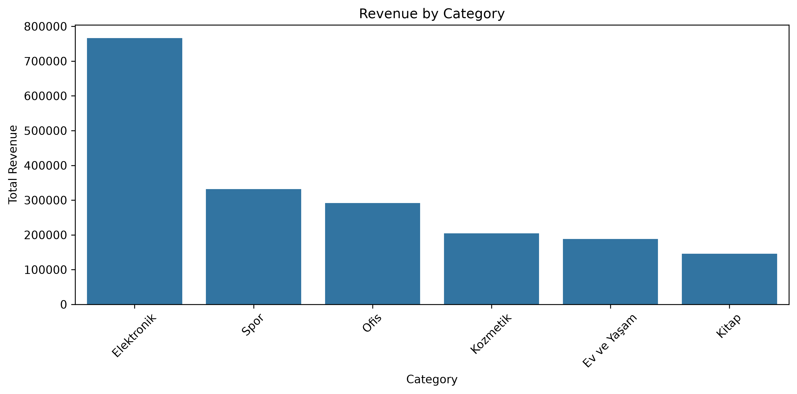
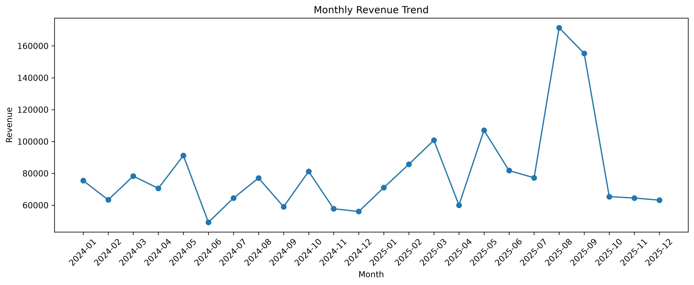
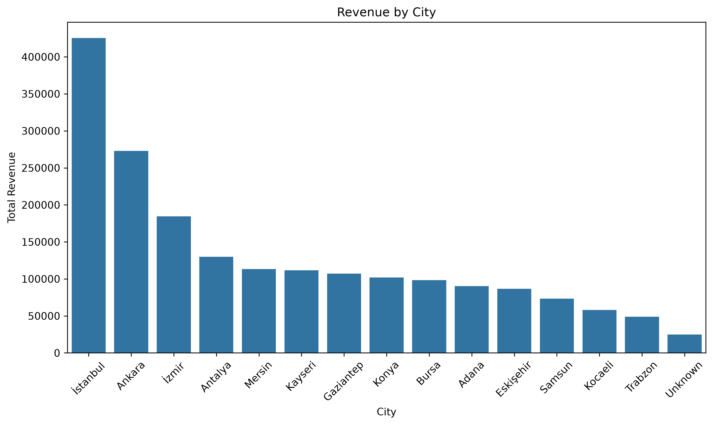
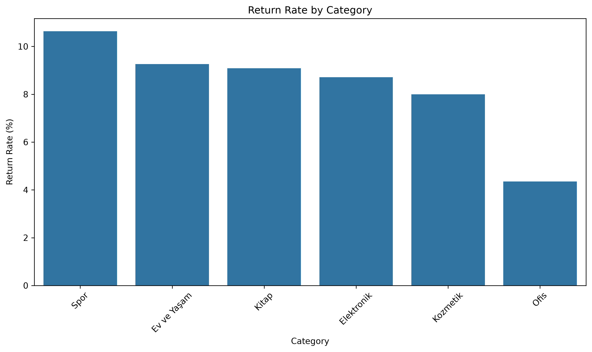
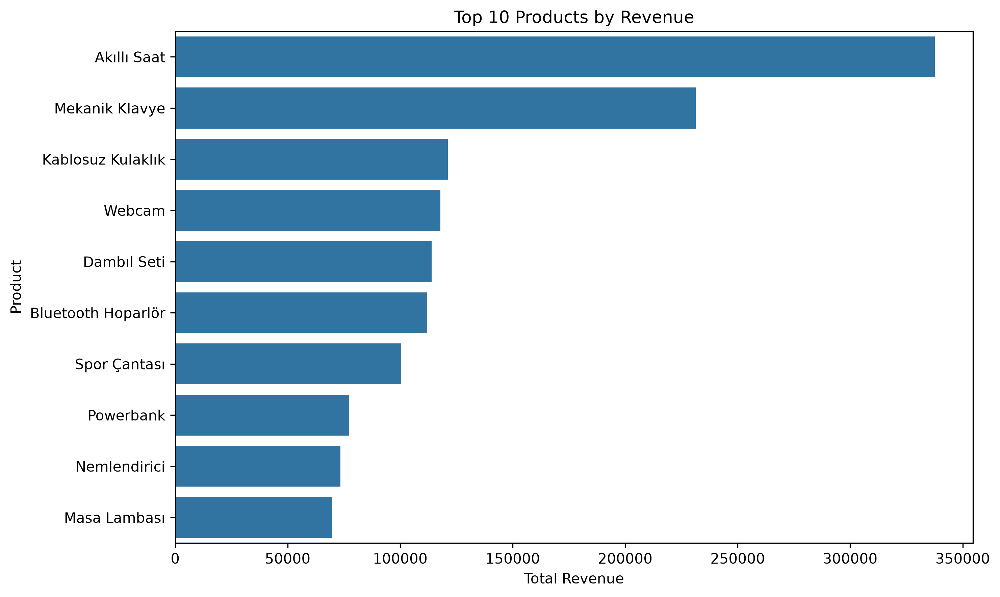
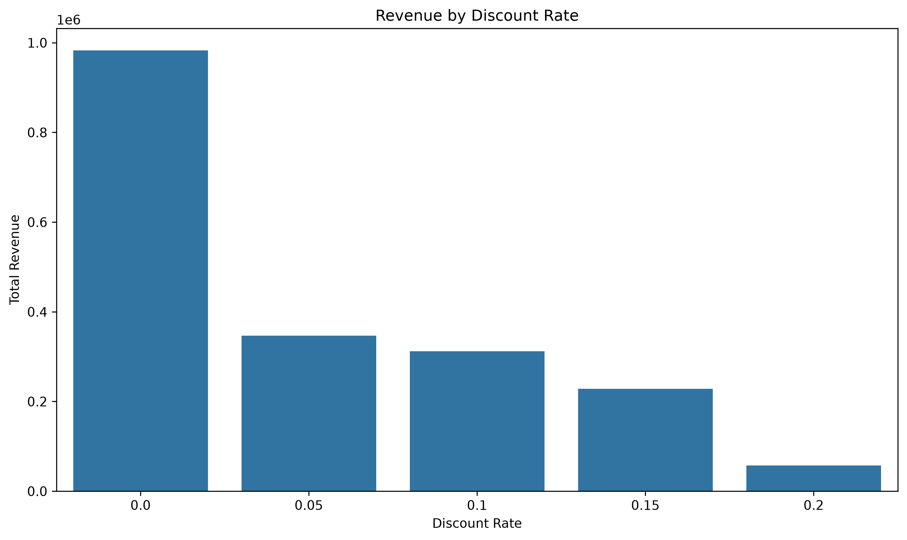

# E-Commerce Data Analysis

## Overview

This project analyzes an e-commerce dataset to explore sales performance, customer behavior, product performance, and operational patterns.

The project includes data cleaning, exploratory data analysis, feature engineering, business-oriented analysis, and data visualization using Python.

---

## Business Questions

The analysis focuses on the following questions:

* How does revenue change over time?
* Which product categories generate the most revenue?
* Which cities and regions contribute the most revenue?
* How do customer types differ in revenue and average order value?
* What are the observed return rates across product categories?
* Which payment methods generate the most revenue?
* What is the typical delivery time?
* Which products generate the highest sales volume and revenue?
* How do discount rates relate to revenue and profit margin?

---

## Dataset

The dataset contains **1,428 records** and **18 variables** before data cleaning.

The dataset includes information about:

* Orders and customers
* Order dates
* Cities and regions
* Product categories and product names
* Quantity and unit price
* Discount rates
* Shipping fees
* Payment methods
* Customer types
* Delivery times
* Customer ratings
* Return status
* Profit margin rates
* Total order amounts

The records cover the period from **January 2024 to December 2025**.

---

## Data Cleaning

The following steps were applied during data preparation:

* Renamed the original Turkish column names to English
* Converted order dates to datetime format
* Standardized inconsistent categorical values
* Handled missing values using appropriate strategies
* Preserved missing customer ratings rather than imputing artificial values
* Removed **28 duplicate records**
* Standardized payment method labels
* Performed final data validation

After cleaning, the dataset contained **1,400 records**.

Outliers were identified using the **Interquartile Range (IQR)** method. Detected outliers were inspected and retained when there was no clear evidence that they represented invalid records.

---

## Exploratory Data Analysis

The exploratory analysis includes:

* Numerical summary statistics
* Categorical variable analysis
* Missing value analysis
* Duplicate detection
* Outlier analysis
* Distribution analysis of key numerical variables

---

## Feature Engineering

The following time-based features were created from the order date:

* `order_year`
* `order_month`
* `year_month`

These features were used to support time-based revenue analysis.

---

## Business Analysis

### Monthly Revenue

Monthly revenue was analyzed to identify changes in sales performance over time.

### Category Performance

Revenue, order count, and average order value were compared across product categories.

**Electronics** generated the highest total revenue, while **Books** had the highest order count but a substantially lower average order value.

### City Performance

Revenue, order count, and average order value were analyzed across cities.

**Istanbul** generated the highest total revenue among the cities in the dataset.

Some cities with relatively low order volumes showed higher average order values.

### Region Performance

Revenue and order volume were compared across geographic regions.

**Marmara** generated the highest total revenue and had the highest order volume.

### Customer Type

Revenue, order count, and average order value were compared across new, existing, and VIP customers.

### Return Analysis

The overall observed return rate was approximately **8.36%**.

Return rates varied across product categories:

* Sports: **10.64%**
* Home & Living: **9.26%**
* Books: **9.09%**
* Electronics: **8.71%**
* Cosmetics: **8.00%**
* Office: **4.35%**

These values describe patterns observed in the dataset and do not establish causal relationships.

### Payment Method

Revenue, order count, and average order value were analyzed across payment methods.

### Delivery Performance

The average delivery time was approximately **3.37 days**.

The observed correlation between delivery time and customer rating was approximately **0.004**, indicating that no meaningful linear relationship was observed between these variables in this dataset.

### Product Performance

Products were analyzed using both quantity sold and total revenue.

The product with the highest sales volume was **Time Management**, with **138 units sold**.

The highest-revenue product was **Smartwatch**, generating approximately **337,672.50** in revenue.

This demonstrates that sales volume and revenue can represent different aspects of product performance.

### Discount & Profitability

Revenue and average order value were analyzed across discount levels.

The observed correlation between discount rate and profit margin rate was approximately **-0.002**, indicating that no meaningful linear relationship was observed between these variables in this dataset.

---

## Key Findings

* **Electronics** generated the highest category revenue with approximately **765,989.55**.
* **Books** had the highest category order count with **253 orders**, but the lowest average order value among the categories.
* **Istanbul** generated the highest city revenue with approximately **425,461.93**.
* The overall observed return rate was approximately **8.36%**.
* **Sports** had the highest observed category return rate at **10.64%**.
* The average delivery time was approximately **3.37 days**.
* The observed delivery time–customer rating correlation was approximately **0.004**.
* **Time Management** had the highest sales quantity with **138 units**.
* **Smartwatch** generated the highest product revenue with approximately **337,672.50**.
* The observed discount rate–profit margin correlation was approximately **-0.002**.

---

## Visualizations

The project generates the following visualizations:

* Monthly revenue trend
* Revenue by category
* Revenue by city
* Revenue by region
* Revenue by payment method
* Return rate by category
* Delivery time distribution
* Top products by quantity
* Top products by revenue
* Discount rate vs. profit margin rate

### Revenue by Category



### Monthly Revenue Trend



### Revenue by City



### Return Rate by Category



### Top Products by Revenue



### Discount Rate vs. Profit Margin



---

## Technologies

* Python
* Pandas
* NumPy
* Matplotlib
* Seaborn
* Jupyter Notebook

---

## Project Structure

```text
e-commerce-data-analysis/
│
├── data/
│
├── notebooks/
│   └── 01_exploratory_data_analysis.ipynb
│
├── src/
│   ├── __init__.py
│   ├── data_cleaning.py
│   ├── analysis.py
│   └── visualization.py
│
├── visualizations/
│   ├── monthly_revenue_trend.png
│   ├── revenue_by_category.png
│   ├── revenue_by_city.png
│   ├── revenue_by_region.png
│   ├── revenue_by_payment_method.png
│   ├── return_rate_by_category.png
│   ├── delivery_time_distribution.png
│   ├── top_products_by_quantity.png
│   ├── top_products_by_revenue.png
│   └── discount_vs_profit_margin.png
│
├── .gitignore
├── README.md
└── requirements.txt
```

---

## How to Run

### 1. Clone the repository

```bash
git clone <repository-url>
cd e-commerce-data-analysis
```

### 2. Create a virtual environment

```bash
python -m venv venv
```

### 3. Activate the virtual environment

#### macOS / Linux

```bash
source venv/bin/activate
```

#### Windows

```bash
venv\Scripts\activate
```

### 4. Install dependencies

```bash
pip install -r requirements.txt
```

### 5. Launch Jupyter Notebook

```bash
jupyter notebook
```

Open:

```text
notebooks/01_exploratory_data_analysis.ipynb
```

Run the notebook from top to bottom.

---

## Future Improvements

Potential future extensions include:

* Customer segmentation
* Sales forecasting
* Customer churn prediction
* Return prediction
* Machine learning models
* Interactive business dashboards
* Additional statistical analysis
* Advanced feature engineering for machine learning applications
